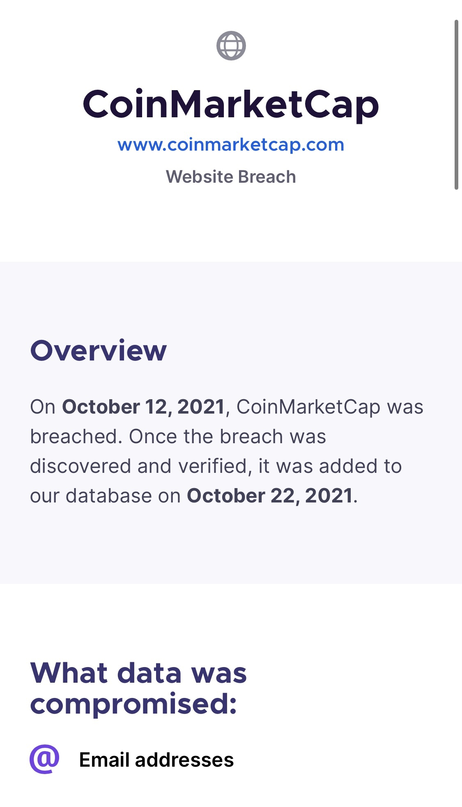
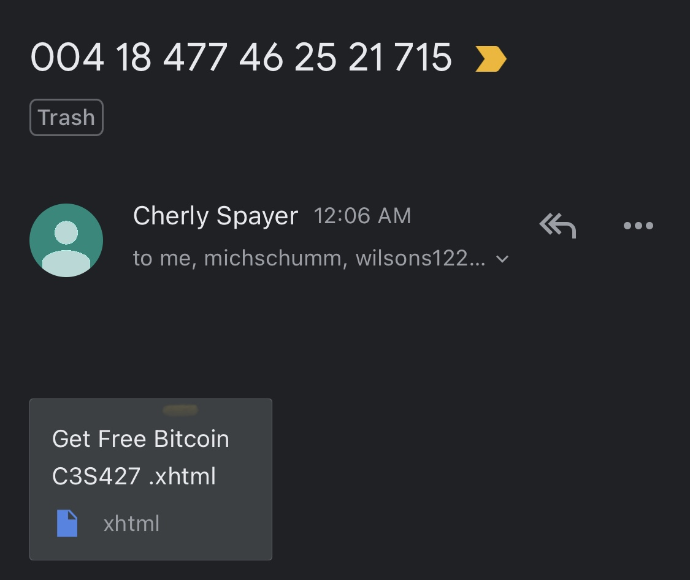
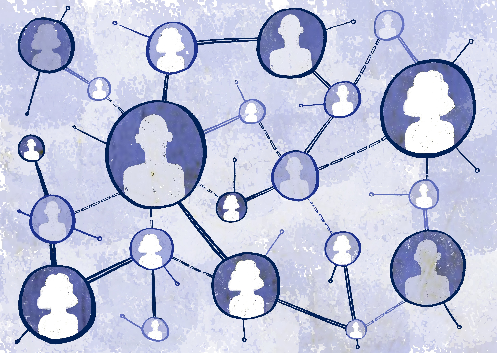

In October 2021, 3.1 million email addresses associated with CoinMarketCap accounts appeared on hacking forums. Mine was among them. Have I Been Pwned verified the correlation with CoinMarketCap accounts, but the precise origin of the addresses remained unclear; CoinMarketCap said it had found no evidence that its own servers had been breached [1]. That uncertainty matters, so I should not present the incident as a confirmed intrusion into CoinMarketCap's systems.

<figure>

<figcaption>

Mozilla Monitor added the exposure to its database on 22 October 2021 [2].

</figcaption>

</figure>

Around the same time, I noticed a wave of phishing messages, many of them related to cryptocurrency. I cannot establish from timing alone that this dataset caused those messages, but the overlap made the risk feel much less abstract.

<figure>

<figcaption>

An example phishing email received today

</figcaption>

</figure>

An address associated with a cryptocurrency service gives a phisher useful context. A message can imitate an exchange, wallet provider, or bank and arrive already knowing which subject is likely to command attention. When a message asks me to sign in urgently, I avoid its link and open the service independently.

I had already begun using Apple's Hide My Email for online accounts. It creates a separate forwarding address instead of disclosing the address I use personally. If one alias is exposed, I can disable it and avoid connecting the same identity across several services. It is useful compartmentalisation, not immunity: phishing can still arrive through the alias, and the account still needs strong authentication.

Mozilla offers a similar service through [Firefox Relay](https://relay.firefox.com/).

No passwords were present in the CoinMarketCap data [1]. That narrows the immediate risk, but it does not erase it. An email address can be combined with public profiles and other breached datasets to make a later attack more specific. The incident therefore raises a question that a password reset cannot answer: why did the service need a persistent, reusable identifier in the first place, and how clearly could it account for the path that identifier took?

The idea I kept returning to was a system in which people hold more of their personal data and grant a service limited access to the particular attributes it needs. Access could be scoped by purpose and time instead of becoming an indefinite copy in another database. Decentralisation does not automatically make such a system secure, and revocation becomes complicated once data has been copied, but the principle of minimising disclosure is worth pursuing.

<figure>

<figcaption>

Source: [Mozilla Foundation](https://foundation.mozilla.org/en/initiatives/new-york-city-internet-health-report/decentralization-/)

</figcaption>

</figure>

I still hope systems move in that direction. The most unsettling part of this incident was not that my password had escaped; it had not. It was discovering how little visibility I had into where a simple piece of personal data had travelled and what somebody else could infer from it.

## References

1. Have I Been Pwned. [CoinMarketCap data breach](https://haveibeenpwned.com/breach/CoinMarketCap).
2. Mozilla Monitor. [CoinMarketCap breach details](https://monitor.mozilla.org/en/breach-details/CoinMarketCap).
