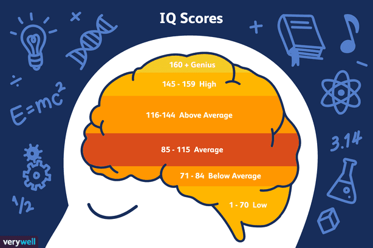

We are remarkably comfortable calling one person intelligent and another less so, even when the two are doing entirely different things. A mathematician, a poet, a navigator, and a surgeon can each display extraordinary judgement, yet the word *intelligence* often collapses those abilities into a single imagined scale.

Psychometric tests make a more specific claim than everyday conversation sometimes gives them credit for. They sample performance on defined cognitive tasks and can predict some educational and occupational outcomes, but they do not measure every ability a culture might value. Reading Howard Gardner's *Frames of Mind* made me question what disappears when a useful measurement becomes our complete definition of a person.

**But the key question remains: Is it fair to rely on a single test to measure intelligence?**

<figure>

<figcaption>

**Classification levels in IQ tests - Image source: [www.verywellmind.com](http://www.verywellmind.com), Joshua Seong**

</figcaption>

</figure>

Gardner's criticism was that conventional testing privileged linguistic and logical-mathematical performance. His response was not merely to add more questions to an IQ test, but to propose that human competence might consist of several intelligences with partly distinct developmental histories [1].

This raises several questions for researchers in the field of intelligence measurement:

Is intelligence a general individual trait? How accurate are the available intelligence tests, whether online or at certified testing centres? Is intelligence the same for everyone around the world, with only varying levels? Is it fair to say that one person is more or less intelligent than another? Can we adopt a single perspective on intelligence despite the diverse areas of human excellence?

In 1983, psychologist Howard Gardner introduced the theory of multiple intelligences in _Frames of Mind_. The original account described seven intelligences and argued for their relative autonomy [1]. The word *relative* is important. Later empirical work has found substantial correlations among tests designed to represent the proposed intelligences, and systematic reviews have not established that teaching students according to a supposed intelligence profile improves learning [2, 3]. I find the framework provocative; I should not present it as settled cognitive science.

<figure>

<figcaption>

Professor Howard Gardner, the creator of the theory of multiple intelligences - [https://metode.org](https://metode.org)

</figcaption>

</figure>

Several examples in the book stayed with me because they make the cost of using one narrow comparison vivid:

1. A 12-year-old Caribbean boy from a family of sailors who have passed down the trade from generation to generation. This boy, despite his young age, is a skilled sailor. His proficiency requires extensive knowledge of wind patterns, weather forecasts, celestial navigation, and geography, relying entirely on traditional methods without advanced navigation devices.

2. An Iranian child who memorised the Quran at a very young age, spoke Arabic alongside his native Persian, and excelled in religious study.

3. A 14-year-old Parisian girl who had mastered a demanding musical system and produced sophisticated compositions.

Each example involves knowledge, memory, perception, and judgement, but in different proportions. A conventional cognitive test may capture some of those abilities and miss others. That is a reason to resist over-interpreting a score, although it does not by itself prove that each ability is an independent intelligence.

Ask for the “smartest person ever” and the question itself pushes us towards scientists whose achievements resemble the abilities associated with intelligence in school. The answer may reveal as much about our cultural definition of intelligence as it does about the people named.

In this book, or rather this theory, the author identifies seven types of intelligence, also known as multiple intelligences:

- Linguistic intelligence

- Musical intelligence

- Logical-mathematical intelligence

- Spatial intelligence

- Bodily-kinesthetic intelligence

- Interpersonal intelligence

- Intrapersonal intelligence

One criterion Gardner used was evidence that an ability could be selectively impaired after brain damage while other abilities remained comparatively intact. This was evidence for separability, not a claim that every intelligence occupies one isolated piece of brain tissue [1].

He also required an intelligence to support problem-solving or the creation of products valued within a culture. His criteria drew on developmental, neurological, evolutionary, and symbolic evidence rather than one decisive experiment [1].

**This leads to another question: Why should we identify and understand different types of intelligence?**

The educational attraction is easy to understand. If ability has several forms, a school that notices only one may overlook genuine strengths. Yet this is also where the theory is most often stretched beyond its evidence. A useful reminder to vary examples and value different forms of competence does not prove that each learner has a fixed “intelligence type”, or that a lesson becomes more effective when matched to it [3].

Genes and environments both contribute to differences in cognitive performance, and their effects cannot be reduced to one universal percentage. Heritability is a population statistic, not a forecast of an individual's potential, and it can change across populations and environments [4]. Whatever capacities a person begins with, expertise still requires access, instruction, practice, and a culture that makes the activity imaginable. A child with unusual potential for chess cannot develop it without encountering chess.

This leaves me with a more careful reason to read Gardner. His framework is valuable as a challenge to narrow educational judgement and as a vocabulary for discussing varied human competence. Whether the proposed intelligences are psychometrically independent is a separate empirical question, and the evidence there is much less friendly to the theory [2, 3, 5].

In the next part of this article, we will explore this relationship further and continue reading about the theory of multiple intelligences. We will also learn about internal and external sources of intelligence and the author's suggestions for establishing scientific frameworks for measuring individual intelligence (especially in students) and how this measurement can improve the educational process.

## References

1. Gardner, H. (1983). *Frames of Mind: The Theory of Multiple Intelligences*. Basic Books.
2. Visser, B. A., Ashton, M. C., & Vernon, P. A. (2006). [Beyond g: Putting multiple intelligences theory to the test](https://doi.org/10.1016/j.intell.2006.02.004). *Intelligence*, 34(5), 487–502.
3. Ferrero, M., Vadillo, M. A., & León, S. P. (2021). [A valid evaluation of the theory of multiple intelligences is not yet possible: Problems of methodological quality for intervention studies](https://doi.org/10.1016/j.intell.2021.101566). *Intelligence*, 88.
4. Plomin, R., & Deary, I. J. (2015). [Genetics and intelligence differences: five special findings](https://doi.org/10.1038/mp.2014.105). *Molecular Psychiatry*, 20, 98–108.
5. Waterhouse, L. (2006). [Multiple Intelligences, the Mozart Effect, and Emotional Intelligence: A Critical Review](https://doi.org/10.1207/s15326985ep4104_1). *Educational Psychologist*, 41(4), 207–225.
