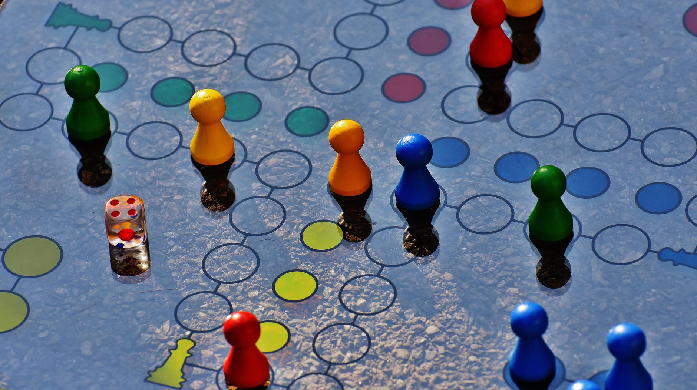

In the [first part](/blog/frames-of-mind-01), I introduced Howard Gardner's theory and the question that drew me to it: what do we lose when intelligence is treated as one rankable quantity? I also added an important qualification. The theory is influential in education, but evidence does not clearly support the claim that its proposed intelligences operate independently or that instruction should be matched to a learner's supposed profile [2, 3].

This second part returns to Gardner's descriptions of the intelligences and his educational argument. I am reading them as a framework to examine, not a map of the mind whose borders neuroscience has confirmed.

**Using Neuroscience to Understand Cognitive Traits**

Development emerges from interaction between biology and environment, so neither a gene-only nor an environment-only story is adequate. Gardner draws on two relevant ideas, canalisation and plasticity, but neither one establishes the existence of his seven intelligences.

The concept of canalization, proposed by British biologist Conrad Waddington in the late 1940s, simply means the tendency of organic systems to follow specific developmental paths. For example, the development of the human nervous system is remarkably predictable: cells first appear in the neural tube of the embryo, then gradually move towards the areas forming the brain and spinal cord to become part of it.

Plasticity describes the nervous system's capacity to change with development, experience, and injury. Outcomes after hemispherectomy show that young brains can reorganise some language functions remarkably well, but the result is not guaranteed fluency without cost, and age is not the only variable. A review of language after childhood hemispherectomy found substantial variability in vocabulary, grammar, and processing [6]. I have therefore removed the earlier absolute comparison between infants and adults; it claimed far more than the evidence justified.

Plasticity gives education a reason to take experience seriously. It does not tell us that every child has one dominant intelligence or that teaching should be labelled accordingly.

## Reading Gardner's categories

### Linguistic intelligence

Gardner uses linguistic intelligence for sensitivity to the meanings, sounds, rhythms, and practical uses of language. Poetry makes those sensitivities unusually visible, but persuasion, storytelling, translation, and ordinary conversation also require them.

But it is not only poetry that defines linguistic intelligence. Eloquence, the ability to use words persuasively enough to change an opinion or inspire action, is another example, as seen in political leaders.

Language in most adults is strongly left-lateralised, but it depends on distributed networks rather than one “language centre”. Damage associated with Broca's aphasia commonly disrupts fluent speech and grammatical production; comprehension may be better preserved than production and is not accurately described as simply lost [7].

### Musical intelligence

Musical intelligence is linked to auditory and verbal abilities. Individuals with high musical intelligence can understand the properties of rhythms and reproduce them accurately.

Most people can perceive pitch, rhythm, and melodic relations to some degree, while training and culture shape how those relations are organised and named. Calling this an intelligence is Gardner's theoretical choice, not a conclusion forced by the existence of musical skill.

Although music is similar to languages in terms of structure and reliance on sounds, musical intelligence is different from linguistic intelligence because the brain processes and stores musical compositions differently than it does words.

Music and language overlap in some cognitive resources and differ in others. The earlier version of this article gave precise error rates from an experiment without a traceable citation. I have removed them rather than preserve numbers I cannot verify.

### Logical-mathematical intelligence

This type of intelligence begins with interacting with the world of objects and gradually evolves into abstract worlds of logic and science.

When it comes to mathematics, memory strength is not a crucial feature for mathematicians. Instead, their ability to understand logical connections between mathematical problems and grasp their general meaning is more important.

Mathematics is similar to poetry or painting, as all three focus on patterns, connections, and ideas rather than languages or sounds.

### Spatial intelligence

This intelligence involves the ability to accurately perceive the visual world and transform, modify, or recreate that perception, even if the visual stimulus is no longer present.

Although perception is strongly linked to visual understanding, spatial intelligence can function independently of the ability to see. This means that even blind individuals can possess exceptional spatial intelligence.

Those with high spatial intelligence can navigate their way, whether in a small room or in the middle of the ocean. This intelligence also provides a great sensitivity to fine details and characteristics in visual presentations, such as paintings, sculptures, and even architectural structures.

In fact, spatial intelligence can be used in a more abstract manner, such as drawing connections between different fields that may not appear related at first glance.

Scientific models often use spatial representation to make an otherwise abstract relationship inspectable. That connection is interesting without attaching an unverified anecdote to a particular scientist.

### Bodily-kinaesthetic intelligence

Although many people do not associate physical activities and skills with intelligence, this is not true at all.

This misconception stems from the traditional association of intelligence with the mind and logic alone, as suggested by single intelligence theories.

However, upon closer examination, we notice that many precise tasks also involve physical activity. For example, a surgeon performing a very delicate operation relies not only on theoretical surgical knowledge but also on the precise movements of their hands, which are crucial for the success of the surgery.

Therefore, it is incorrect to claim that the brain does not play a role in physical movement. On the contrary, the brain helps improve, redirect, and adapt physical behaviour to better serve individual goals. The brain and body constantly communicate to execute many fine motor tasks.

## The personal intelligences

### Intrapersonal and interpersonal intelligence

Internal personal intelligence involves an individual's ability to connect with their inner thoughts, feelings, and emotions.

In contrast, external personal intelligence revolves around understanding others, specifically their moods, mental states, motivations, and intentions.

These abilities involve several interacting systems for memory, emotion, social perception, and executive control. Locating both “in the frontal lobes”, as the earlier version did, turns a distributed and contested account into a false anatomical certainty.

## What should education do with the theory?

If you wanted to teach someone computer programming, what intelligences would you use? Most people would choose the most obvious answer: logical-mathematical intelligence. Some might say linguistic intelligence is also important, as programming involves learning programming languages.

Diagrams can make program structure visible; pair programming can expose a learner to another person's reasoning; spoken explanation can uncover gaps in understanding. These are defensible teaching options because they represent the material in different ways and support different learning activities. It does not follow that a student should receive one of them because a test has labelled the student “spatial”, “interpersonal”, or “linguistic”. Reviews of matching instruction to multiple-intelligence profiles have not produced a sound evidential basis for that practice [3].

Gardner proposed broader forms of assessment, repeated across development and grounded in meaningful activities rather than a single short test [1]. The aspiration is humane, although a profile can become another label if its uncertainty and context are forgotten.

The second step, according to the author, is for educational institutions to review their goals. For example, if a program's goal is "to educate individuals and help them achieve their full potential," this goal is too general to be useful. On the contrary, the more specific the goal, the easier it is to analyse the intellectual skills needed to teach and learn it.

Next, educators should identify ways to use intelligence as both a means and an end. In other words, they should explore how intelligence can be used to teach a skill and how intelligence itself is part of that skill. For example, a child who struggles to learn to read through traditional methods might benefit from learning through physical exploration to understand the shapes of letters.

My conclusion is more restrained than the one I originally wrote. Education should recognise a wider range of human competence, use varied representations, and give students more than one way to demonstrate understanding. Multiple-intelligences theory helped popularise that conversation. Those values can survive even if the theory's strongest psychological claims do not.

**Reflection: Relevance to Artificial Intelligence**

Gardner's categories should not be copied directly into AI. A system that processes music has not thereby acquired “musical intelligence” in the human developmental and cultural sense. Nor does combining language, vision, and audio models demonstrate that the theory was neurologically correct.

The connection I still find useful is methodological. AI researchers also have to decide what they will recognise as intelligence and how they will measure it. A benchmark can become as distorting as an IQ score when performance on a narrow task quietly stands in for every form of competence. Gardner's framework reminds me to ask what a measurement excludes, even when I do not accept each intelligence as an independent faculty.

That is the part of the theory I want to keep: not seven new boxes into which every mind must fit, but resistance to the idea that one convenient measurement exhausts a complicated phenomenon.

## References

1. Gardner, H. (1983). *Frames of Mind: The Theory of Multiple Intelligences*. Basic Books.
2. Visser, B. A., Ashton, M. C., & Vernon, P. A. (2006). [Beyond g: Putting multiple intelligences theory to the test](https://doi.org/10.1016/j.intell.2006.02.004). *Intelligence*, 34(5), 487–502.
3. Ferrero, M., Vadillo, M. A., & León, S. P. (2021). [A valid evaluation of the theory of multiple intelligences is not yet possible: Problems of methodological quality for intervention studies](https://doi.org/10.1016/j.intell.2021.101566). *Intelligence*, 88.
4. Waterhouse, L. (2006). [Multiple Intelligences, the Mozart Effect, and Emotional Intelligence: A Critical Review](https://doi.org/10.1207/s15326985ep4104_1). *Educational Psychologist*, 41(4), 207–225.
5. Plomin, R., & Deary, I. J. (2015). [Genetics and intelligence differences: five special findings](https://doi.org/10.1038/mp.2014.105). *Molecular Psychiatry*, 20, 98–108.
6. Curtiss, S., de Bode, S., & Mathern, G. W. (2001). [Spoken language outcomes after hemispherectomy: Factoring in etiology](https://doi.org/10.1093/brain/124.3.642). *Brain*, 124(3), 642–653.
7. Fridriksson, J. et al. (2015). [Anatomy of aphasia revisited](https://doi.org/10.1093/brain/awv234). *Brain*, 138(12), 3414–3429.
