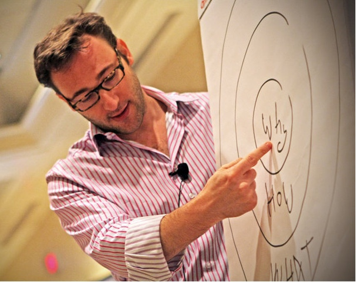
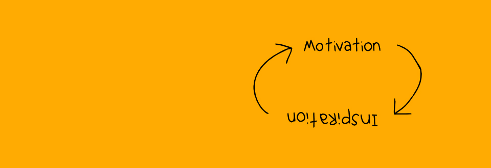
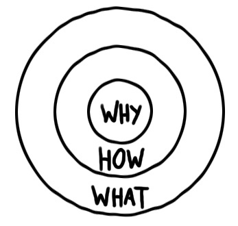

A few days ago, I [reviewed *Start With Why*](/blog/start-with-why-simon-sinek) by Simon Sinek. I struggled with the book and then found the [TED talk](https://www.ted.com/talks/simon_sinek_how_great_leaders_inspire_action) from which its central idea grew. In eighteen minutes, the Golden Circle felt both clearer and more useful than it had across hundreds of pages.

<figure>

<figcaption>

_Simon Sinek explaining his discovery of the golden circle._

</figcaption>

</figure>

Sinek presents it as a pattern in how inspiring leaders think and communicate. I am less certain than he is that the pattern is universal, and I would not now call leadership a science that can be taught identically to anyone. What I do believe is that leadership contains skills that can be practised, criticised, and improved.

As a matter of fact, leadership, although usually used in a positive context, is not exclusively reserved for righteousness. On the contrary, we can list countless examples of immoral and dishonest leaders who, beyond any doubt, played a major role in history and affected the course of humanity throughout the years.

This takes us back to the simplest question we could ask: **What is leadership?**

If we conducted a poll, I can almost guess that the majority of the participants would list motivation as the one word most suitable to be linked with leadership. Therefore, it is natural to conclude that the mere definition of leadership, according to this hypothesis, is "**The ability to motivate.**" But is it the right assumption, though?

Different people are motivated by a variety of different reasons, including fear. The fear of being penalised motivates people to finish their job within the deadline. Embarrassment, on the other hand, can motivate people to act in a certain way in a given situation. And, above all, someone's authority can admittedly motivate people to follow orders.

Throughout my career, I have worked with different managers who, by closely following up with their subordinates, collecting reports, conducting weekly meetings, and setting deadlines, presumed that this would entitle them to the status of good leadership. However, in reality, they had only mastered the way of getting things done from others, i.e., the very basic definition of management. In fact, some of those managers used to manipulate and take advantage of others' hard work for personal gain. It's true that these individuals are also considered leaders. In fact, every manager, boss, or anyone with established authority is considered a leader by assignment. So how can we distinguish between good and bad leadership models?

The distinction I was trying to make was between obtaining compliance and building commitment. A manager can produce activity through deadlines, reporting, and authority. Leadership becomes more interesting when people understand the purpose of the work well enough to exercise judgement without waiting for another instruction. Inspiration may help, but it should not become a romantic substitute for competence, fair conditions, and accountability.

**Motivation vs Inspiration**

I originally drew a very clean line between motivation as an external push and inspiration as an internal pull. The line is rhetorically attractive and psychologically untidy. Self-determination theory, for example, distinguishes several forms of motivation along a continuum rather than sorting all behaviour into “pushed” and “inspired” [1].

What I was reaching for still matters. A deadline can make someone complete a task without making the task meaningful. A purpose can help people connect their choices to a wider outcome, although purpose alone cannot guarantee performance or loyalty. The useful question is how a leader communicates that connection without turning it into another slogan. This is where Sinek's Golden Circle enters.

**The Golden Circle**

Sinek claims that inspiring leaders and organisations communicate in a shared pattern, which he calls the **Golden Circle** [2]. I treat it as a communication model rather than a law of leadership. It contains three parts: Why, How, and What.

**What:** Every single person or organisation on the planet knows what they do. Every organisation can easily describe the products or services they sell, and every person can easily describe the job function they have within the company.

**How:** Some people or companies know how they do what they do, i.e., how they make it different or better than the competitors. In the case of individuals, it is the ability to describe how they perform their job in a way that achieves the desirable outcomes.

**Why:** This is the tricky part; there are only a few people or organizations that can clearly articulate why they do what they do. This isn't about making a profit or getting a promotion, in the case of individuals; that's a result. Why is all about your purpose. Why does your company exist? What's your belief? Why do you get out of bed in the morning?

Communication often begins with the visible result: what must be delivered, when, and according to which process. The purpose is either assumed or replaced with “because top management requires it”, which is a source of authority rather than an explanation.

Beginning with purpose can change the conversation. If people understand what an outcome protects or enables, they can suggest a better method, recognise when the prescribed method undermines the goal, and make trade-offs with more context. None of this happens automatically. A clear “why” does not compensate for poor incentives, missing skill, or a leader who ignores criticism.

What changed in my thinking was therefore smaller than Sinek's promise and more practical. I began asking for the reason behind a request before optimising its execution. Sometimes the answer reveals a better way to do the work. Sometimes it reveals that the work should not be done at all. That is enough to make the Golden Circle useful, even if it is not the universal law its neat geometry suggests.

## References

1. Ryan, R. M., & Deci, E. L. (2000). [Intrinsic and Extrinsic Motivations: Classic Definitions and New Directions](https://doi.org/10.1006/ceps.1999.1020). *Contemporary Educational Psychology*, 25(1), 54–67.
2. Sinek, S. (2009). *Start With Why: How Great Leaders Inspire Everyone to Take Action*. Portfolio.
