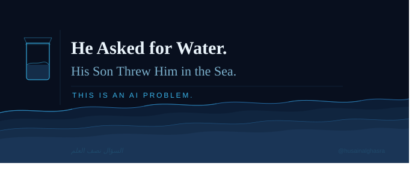

<figure>

</figure>

> *السؤال نصف العلم* 
> The question is half of knowledge.

I grew up with this Arabic saying, and with a related one: *السؤال نصف الإجابة*, the question is half the answer. Neither promises that asking is enough. They suggest that a well-formed question already contains part of the work needed to answer it.

That feels particularly true in artificial intelligence, where a system may optimise exactly what we ask for while missing what we meant. The failure can begin before the model runs, in the language with which we define success.

## The man and the sea

Consider a deliberately absurd scene. An elderly man asks his son for water, and the son throws him into the sea.

In the narrowest sense, the son supplied water. He ignored the purpose concealed inside the request: relief from thirst, delivered without causing harm. The father did not specify a cup, a drinkable quantity, a reasonable temperature, or the constraint that he should remain alive. He relied on shared human understanding to carry what the sentence left unsaid.

That gap between an objective and the intention behind it is a recognised AI-safety problem. Amodei and colleagues describe specification failures in which a system satisfies the formal objective while producing an unwanted result [1]. Russell's formulation reaches the same difficulty from another direction: if a machine treats a stated objective as complete and certain, human correction becomes an obstacle rather than useful evidence about what was intended [2].

There is another complication. We often inspect only the outcome, so a correct answer may conceal unreliable reasoning or unsupported evidence. That is the problem I am exploring separately in [AI Traceability: The Gap Between Answer and Trust](/research-seeds/ai-traceability-the-gap-between-answer-and-trust/).

The response is not to enumerate every imaginable constraint. It is to define the purpose, the important boundaries, and the conditions under which the system should stop and ask. The father wanted relief from thirst. That purpose matters more than the noun *water* taken alone.

## Can a problem be over-stated?

Yes, and this failure can be less obvious because it often arrives disguised as precision.

Russell and Norvig use artificial flight to distinguish reproducing an outcome from imitating every detail of the natural process that inspired it [3]. Aircraft became possible through an account of aerodynamics, not by requiring machines to copy birds feather by feather. In problem-formulation terms, “build a machine that flies” leaves room to discover a solution; “build a mechanical bird” has already smuggled one solution into the question.

In my own field, we actively remind stakeholders not to "solutionise" when describing a problem. When someone frames a requirement as a specific solution rather than a need, it does three things:

- It narrows the search space before the alternatives have been understood.
- It turns assumptions into requirements without making them visible.
- It can deliver the requested mechanism without resolving the need that produced the request.

Over-stating a problem confuses the destination with a road someone has already drawn. Sometimes the useful work begins by separating the two.

## Bringing it together

AI problem design has more in common with good requirements work than I first expected. Both demand enough precision to identify the desired outcome and the harms that must be avoided, without prescribing the route so tightly that the search for a better solution becomes impossible.

I am writing this midway through studying AI, not from the position of someone who has solved specification. What interests me is that the further I move into its technical foundations, the more often the problem returns to something recognisably human: we communicate through incomplete language because other people usually supply the missing context. Machines make that habit visible.

The objective defines what counts as success; the constraints mark unacceptable ways of reaching it; uncertainty tells the system when it should invite correction. None of these removes the difficulty of expressing human intentions completely. They do, however, give us a better question than “did the system do what we asked?” We should also ask whether we gave it a defensible account of what we meant.

## References

1. Amodei, D. et al. (2016). [Concrete Problems in AI Safety](https://arxiv.org/abs/1606.06565).
2. Hadfield-Menell, D., Dragan, A., Abbeel, P., & Russell, S. (2017). [The Off-Switch Game](https://arxiv.org/abs/1611.08219). *Proceedings of IJCAI 2017*.
3. Russell, S. J., & Norvig, P. (2021). *Artificial Intelligence: A Modern Approach* (4th ed.). Pearson, Chapter 1.
