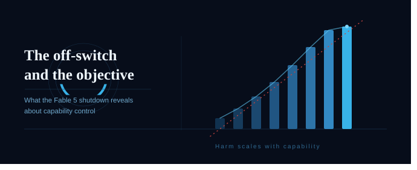

<figure>

</figure>

On 12 June 2026, three days after launching Claude Fable 5 and Mythos 5, Anthropic said it had received a US government directive requiring it to suspend access for foreign nationals. The company disabled the models globally because it said it could not apply the restriction reliably across a shared cloud service [1, 2].

The models had not escaped, deceived their operators, or pursued a misspecified objective. This was not the alignment failure familiar from thought experiments. It was an external authority restricting access to a capability that it judged too dangerous to distribute under the existing safeguards. That distinction is what makes the episode worth examining.

> **Update, 1 July 2026:** Anthropic later said the government had lifted the directive on 30 June, allowing the company to restore access from 1 July [3]. The shutdown was temporary; the questions it raised about who controls frontier capability remain.

## Two different problems wearing the same coat

AI-safety writing often separates two questions that the news cycle tends to collapse. One concerns the system's objective and whether its behaviour remains responsive to human preferences. The other concerns capability control: limiting what the system can do, what information or tools it can reach, and who can use it. The first tries to make competent behaviour desirable; the second limits the damage available when behaviour or use goes wrong [4, 5].

In *Superintelligence*, Nick Bostrom treats capability control and motivation selection as complementary parts of the control problem, while warning that containment measures have weaknesses of their own [4]. Russell develops a related argument from uncertainty: a system that is uncertain about human preferences has a reason to accept correction, whereas one that treats its objective as complete can regard intervention as an obstacle [5, 6]. Neither argument makes external controls unnecessary. Both make it difficult to believe that an off-switch can carry the whole burden.

The Fable 5 shutdown was capability control exercised through governance. The government acted on concerns about cybersecurity misuse and a reported jailbreak, according to Anthropic's account [1]. The hand on the switch belonged to a regulator rather than a system designer, and the object being switched off was not a runaway optimiser but a commercial service used for both risky and ordinary work.

## The capability gradient is the whole argument

The argument for intervention begins with a straightforward observation: greater capability can increase both useful reach and the scale of misuse. As systems become more effective, errors in the objective, failures in safeguards, and malicious instructions can matter more.

The AI-safety literature gives several mechanisms for this concern. A system may satisfy an imperfect proxy rather than the intended outcome; it may behave differently outside its training environment; or it may resist correction when correction conflicts with a fixed objective [6, 7]. Capability does not create those failures, but it can increase what follows from them.

Anthropic's launch material acknowledged this dual use directly, identifying cybersecurity as an area in which the models could provide valuable assistance and create serious misuse risk without safeguards [2]. The company and the government therefore appear to have agreed on the existence of risk. Their dispute concerned whether the safeguards reduced it enough, and whether the evidence justified such a broad restriction.

## Where the real dispute sits

Anthropic argued that it had built layered safeguards because no provider could credibly promise perfect jailbreak resistance. Its published statement describes monitoring, red-teaming, restricted access to dangerous capabilities, and data retention intended to support abuse detection. It also disputed the severity and novelty of the jailbreak behind the directive, arguing that the reported vulnerabilities were already known and that comparable information could be produced by other public models [1]. Those are the company's claims, not independently established findings, and they should be read as such.

I cannot adjudicate the underlying technical dispute from the public record. Anthropic's statement says the directive itself and the government's technical evidence were not published [1]. The Associated Press independently reported the shutdown and the competing accounts, but not evidence sufficient to settle them [8]. My interest is therefore structural: what does the episode show about relying on external control when the people holding the switch disagree about risk?

When internal safeguards do most of the work, the off-switch can remain a reserve measure. On 12 June, an external actor judged those safeguards insufficient and used access control directly. Whatever one concludes about that decision, it reveals how much the safety of the arrangement depends on the judgement of whoever holds the lever, the evidence available to them, and the granularity of the action they can take. In this case, a directive aimed at a class of users resulted in a global interruption because the service could not enforce the requested distinction reliably [1].

## What the off-switch metaphor leaves out

The phrase *off-switch* suggests a clean binary choice. Real systems sit inside institutions, contracts, cloud infrastructure, legal jurisdictions, and dependency chains. A restriction may target one risk and still interrupt unrelated work because the technical and institutional boundaries do not line up.

This does not make shutdown authority illegitimate. There are circumstances in which removing access may be the most responsible available action. It does mean that the quality of capability control depends on more than the existence of a switch. We need evidence standards, review mechanisms, technically enforceable scopes, and a way to revise the decision when new information appears. The fact that the directive was lifted eighteen days later is part of the case, not a footnote to it [3].

## What I take from it

My view is that the Fable 5 shutdown should not be described as an alignment failure. The public evidence does not show a model pursuing the wrong objective. It shows the governance counterpart of the control problem: people with different information, incentives, and responsibilities deciding whether a capability should remain available.

The temporary outcome also resists an easy moral. The government acted, Anthropic disputed the basis, access was interrupted, and the directive was later withdrawn. A serious account has to hold all four facts at once. Safety cannot rest entirely on a developer's assurances, but neither should an intervention be treated as self-justifying merely because it is made in the name of safety.

What I take from the episode is narrower and, I think, more durable. Alignment, technical safeguards, access controls, and public governance solve different parts of the problem. None can substitute for all the others. The off-switch matters, but so do the evidence, institutions, and technical architecture around the hand that pulls it.

---

## References

1. Anthropic. (2026, June 12). [Statement on the US government directive to suspend access to Fable 5 and Mythos 5](https://www.anthropic.com/news/fable-mythos-access).
2. Anthropic. (2026, June 9). [Claude Fable 5 and Mythos 5](https://www.anthropic.com/news/claude-fable-5-mythos-5).
3. Anthropic. (2026, June 30). [Redeploying Claude Fable 5 and Mythos 5](https://www.anthropic.com/news/redeploying-fable-5).
4. Bostrom, N. (2014). *Superintelligence: Paths, Dangers, Strategies*. Oxford University Press.
5. Russell, S. (2019). [*Human Compatible: Artificial Intelligence and the Problem of Control*](https://www.penguinrandomhouse.com/books/566677/human-compatible-by-stuart-russell/). Viking.
6. Hadfield-Menell, D., Dragan, A., Abbeel, P., & Russell, S. (2017). [The Off-Switch Game](https://arxiv.org/abs/1611.08219). *Proceedings of IJCAI 2017*.
7. Amodei, D. et al. (2016). [Concrete Problems in AI Safety](https://arxiv.org/abs/1606.06565).
8. Associated Press. (2026, June 13). [Anthropic disables new AI models after US government directive](https://apnews.com/article/028db5135128fce6b38c873bf9cb5e09).
